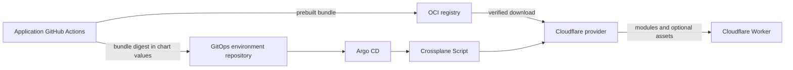

# GitHub Actions to a deployed Worker

This example follows an application bundle from GitHub Actions through a registry,
GitOps, Argo CD and this provider to Cloudflare. Application CI builds the Worker;
the Crossplane controller downloads its immutable release and deploys it.



There are three distinct artifacts in the GitKB integration:

| Artifact | Producer | Consumer |
| --- | --- | --- |
| Worker OCI bundle: module files, `worker-artifact.json`, optional assets | Application repository CI | `Script.spec.artifact.ref` |
| Provider package: controller binary and CRDs | This repository's `.github/workflows/preview-packages.yml` or release publisher | Crossplane `Provider.spec.package` |
| Container image for a private EKS relay | Application repository image job | The environment's private WebService |

The provider-package workflow does not build application code. A Worker bundle is
an OCI artifact, not the relay container image or a GitHub Actions artifact ZIP.
The provider pulls it directly from the registry; it does not download a workflow
run's artifacts from GitHub.

## 1. Give application CI a bundle builder

The application repository needs:

- A committed `package.json` and `pnpm-lock.yaml`.
- `scripts/build-worker-artifact.mjs`, which writes
  `.cloudflare/worker-artifact/worker-bundle.tgz`.
- Build output and `worker-artifact.json` inside that archive, using the
  [bundle format](worker-artifacts.md#build-and-publish).

The tested [Gateway builder](https://github.com/gitkb/harmony-gateway/blob/6e3f12208822b1a0f6ec236bafc8685d1eda575b/scripts/build-worker-artifact.mjs)
runs Wrangler with `deploy --dry-run`, collects the generated modules, writes the
manifest and creates the archive. It never deploys to Cloudflare. Its bundle is
module-only: the Gateway proxies website/dashboard assets from EKS. An application
that deploys Worker Static Assets includes the asset directory in its archive
and selects it in the bundle manifest.

The shared publisher currently uses Node 22 and pnpm 9, installs dependencies with
`pnpm install --frozen-lockfile --ignore-workspace`, then runs that script. This is
the builder contract; there is no configurable build-command or bundle-path input
in this workflow version.

## 2. Publish from GitHub Actions

The following is a complete application-repository workflow for publishing a
bundle on demand and displaying the resulting GitOps value. Save it as
`.github/workflows/publish-worker.yml`:

```yaml
name: Publish Worker bundle

on:
  workflow_dispatch:

permissions: {}

jobs:
  publish:
    permissions:
      contents: read
      id-token: write
    uses: gitkb/workflows/.github/workflows/gitops-publish-worker.yml@c3538ec64bfc31f27f724ea7daf415994a1a5c82
    with:
      image_tag: sha-${{ github.sha }}

  show-gitops-value:
    needs: publish
    runs-on: ubuntu-24.04
    steps:
      - name: Show immutable bundle selection
        env:
          WORKER_REF: ${{ needs.publish.outputs.ref }}
        run: |
          printf '    artifact:\n      ref: "%s"\n' "$WORKER_REF" >> "$GITHUB_STEP_SUMMARY"
```

This pins the implementation from [shared workflows #50](https://github.com/gitkb/workflows/pull/50).
Use an approved immutable workflow revision when adopting it; the example does
not assume the feature is available from the shared repository's default branch.

Configure these application repository or organization variables:

| Variable | Meaning |
| --- | --- |
| `AWS_REGION` | Region containing the ECR repository |
| `ECR_REGISTRY` | ECR registry hostname, without a scheme |
| `ECR_PUBLISH_ROLE_ARN` | Role that trusts this caller's GitHub OIDC identity and can publish to its ECR repository |
| `LINUX_RUNNERS` | `github` selects GitHub-hosted publishing; otherwise use the organization's configured runner policy (the default selects Blacksmith) |

The ECR repository must already exist at
`$ECR_REGISTRY/$GITHUB_REPOSITORY`, for example an ECR repository named
`gitkb/harmony-gateway`. Declare repository permissions and OIDC trust through the
platform's IaC. This workflow does not create the IAM role or repository.

The [shared publisher](https://github.com/gitkb/workflows/blob/c3538ec64bfc31f27f724ea7daf415994a1a5c82/.github/workflows/gitops-publish-worker.yml)
checks out the selected application commit, builds its archive, authenticates to
ECR with GitHub OIDC, then runs the equivalent of:

```sh
oras push "$target" \
  --artifact-type application/vnd.gitkb.cloudflare.worker.v1 \
  worker-bundle.tgz:application/vnd.gitkb.cloudflare.worker.bundle.v1.tar+gzip
digest="$(oras resolve "$target")"
```

The publication tag includes the supplied image tag, run ID and run attempt, so
reruns do not overwrite the same immutable tag. Its `ref` output is the complete
digest reference, such as:

```yaml
artifact:
  ref: 123456789012.dkr.ecr.us-east-2.amazonaws.com/example/worker@sha256:aaaaaaaaaaaaaaaaaaaaaaaaaaaaaaaaaaaaaaaaaaaaaaaaaaaaaaaaaaaaaaaa
```

The tag is a publication handle. GitOps records the resolved manifest digest.
This publishing-only example displays the value; it does not edit an environment
repository or deploy a Worker by itself.

## 3. Automate preview promotion

GitKB's reusable preview workflow combines publication with environment
promotion. In an existing GitOps preview caller, enable `worker_bundle: true`:

```yaml
jobs:
  preview:
    permissions:
      contents: write
      id-token: write
      issues: write
      packages: write
      pull-requests: write
    uses: gitkb/workflows/.github/workflows/gitops-preview.yml@c3538ec64bfc31f27f724ea7daf415994a1a5c82
    with:
      name: harmony-gateway
      dockerfile: Dockerfile.k8s-preview
      apps: true
      worker_bundle: true
    secrets:
      GH_APP_ID: ${{ secrets.GH_APP_ID }}
      GH_APP_KEY: ${{ secrets.GH_APP_KEY }}
      PACKAGES_READ_TOKEN: ${{ secrets.PACKAGES_READ_TOKEN }}
```

This is the job configuration, not a replacement for the caller's events and
lifecycle guards. The [complete Gateway caller](https://github.com/gitkb/harmony-gateway/blob/6e3f12208822b1a0f6ec236bafc8685d1eda575b/.github/workflows/gitops-preview.yaml)
includes trusted PR handling, label/close cleanup, concurrency and slash-command
dispatch. `GH_APP_ID`/`GH_APP_KEY` identify the configured GitHub App used for
environment updates and PR interactions; `PACKAGES_READ_TOKEN` is optional for
callers that need it. Cloudflare API credentials are not supplied to application
CI.

The repository also supplies the normal GitOps promotion/deployment charts and
`.gitops/values/preview.yaml`. With `apps: true`, its declared apps map and saved
PR values are resolved as part of the preview. The Worker option adds these steps
to that existing flow:

1. A trusted same-repository PR labeled `preview` publishes its image and Worker
   bundle in separate jobs. Fork PRs do not enter the privileged publishers.
2. The values job waits for successful publication, then sets `artifact.ref` to
   the Worker publisher's immutable output. The container has its own independent
   `image.tag` digest pin. PR-specific configuration remains an environment-values
   overlay; it is not baked into the bundle.
3. The promotion workflow renders the application's `.gitops/promote` chart into
   `gitkb/gitkb-preview-envs`. Argo reconciles that environment's application and
   its `.gitops/deploy` chart.
4. The deployment chart passes the published reference to `Script.spec.artifact`.
   The Gateway chart needs `runtime: cloudflare` and the environment's account,
   Worker hostname, origins and provider configuration. `worker_bundle: true`
   publishes/pins a bundle; it does not choose a Cloudflare runtime automatically.
5. Closing the PR or removing `preview` removes its environment registration.
   Normal managed-resource deletion removes the deployed Cloudflare resources;
   registry artifact retention is a separate policy.

The [Gateway deployment template](https://github.com/gitkb/harmony-gateway/blob/6e3f12208822b1a0f6ec236bafc8685d1eda575b/.gitops/deploy/templates/cloudflare.yaml)
shows the resulting Script, bindings and private entry configuration. Its
application code executes on Cloudflare; the EKS WebService is a private relay.
An ordinary Worker deployment does not inherently require a relay container.

## 4. Let the provider deploy and verify the result

Platform prerequisites are installed independently: the provider controllers,
Cloudflare ProviderConfig/credentials and Argo permissions for the selected
namespace/resource kinds. Staging owns them in
[harmony-staging-gitops](https://github.com/gitkb/harmony-staging-gitops/blob/main/docs/cloudflare-platform.md).
The pilot project currently permits its specific preview namespace; adding a new
namespace or environment requires the corresponding platform authorization.

The Script's pull Secret is independent of the GitHub publisher's identity:

| Credential | Used by | Purpose |
| --- | --- | --- |
| GitHub OIDC publishing role | Application workflow | Push the Worker OCI bundle |
| GitHub App installation token | GitOps promotion | Update environment intent and PR interactions |
| Docker-config Secret in the Script's namespace | Provider controller | Download that bundle; ECR pull grants and token refresh are platform-owned |
| Cloudflare API credential selected by ProviderConfig | Provider controller | Create/update/delete Cloudflare resources |

After Argo creates or updates the [complete Script resource](worker-artifacts.md#select-the-bundle),
the initializer downloads its exact digest, verifies and extracts the archive,
and supplies local files to the native provider. Cloudflare upload occurs during
managed-resource reconciliation, not during the GitHub publishing job.

Check that `status.resolvedArtifactDigest` matches the selected digest, inspect
normal `Synced`/`Ready` conditions, then exercise the deployed routes and assets.
A fetched digest alone does not establish a healthy deployment. The private
Gateway preview also verifies unauthenticated edge denial, product login/callback
and the selected EKS origins through VPC/Tunnel connectivity.

Rollback changes the GitOps selection to a retained earlier bundle digest. No
rebuild is required. Keep selected and rollback bundles available in the registry
so cache recovery and controller restarts can fetch them again. The provider's
[deletion/restart limitation](worker-artifacts.md#recovery-and-cache-lifecycle)
still applies during cleanup.

## Preview support versus normal releases

The example above describes the implemented preview path. The shared
`gitops-release.yml` workflow currently publishes/promotes the container image;
it does not yet publish and promote the Worker OCI digest. A release integration
must add bundle publication and carry the same immutable `artifact.ref` through
staging/production promotion before those environments can use this provider
path automatically.

Provider release publication is separate too. This repository's
[candidate workflow](../.github/workflows/preview-packages.yml) publishes the
Workers/Zero Trust/Connectivity controller packages for trusted same-repository
PRs; staging GitOps explicitly selects their package digests. The inherited
[tag publisher](../.github/workflows/publish.yml) still uses upstream Wildbit
registry/credential settings. Stable GitKB provider releases require fork-owned
publishing configuration before that path is used.

The existing direct Cloudflare staging deployment workflow is a separate owner.
Keep its Worker separate from a Crossplane-managed Worker, or explicitly hand off
ownership before replacing that deployment path. Publishing a provider package,
publishing a Worker bundle and deploying a Worker are distinct operations.
